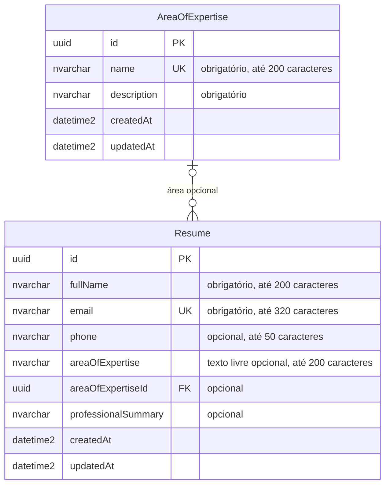

# Diagrama de entidades e relacionamentos

O diagrama representa o schema Prisma do backend no SQL Server.

Uma área pode estar vinculada a nenhum ou vários currículos. Um currículo pode estar vinculado a nenhuma ou uma área; o campo de texto livre também é opcional. A exclusão de uma área referenciada é bloqueada pela chave estrangeira.
